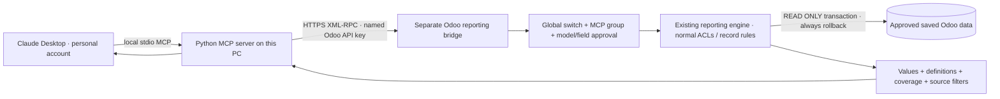

# Claude ↔ Tradeline Odoo reporting

Prepared for an initial **Claude Desktop** installation. This is not deployed or enabled on production, does not install Claude, and contains no real credentials. The existing Odoo chat and its OpenAI/Claude settings are independent.

Claude's personal subscription runs the conversation; this connector does not call a language-model API and needs no Anthropic/OpenAI API key. It needs a named Odoo user's Odoo API key, stored locally. Remote web/mobile access is a separate deployment with HTTPS and per-user OAuth, not a public unauthenticated endpoint.

## What is exposed?

Nothing by default. All of these must permit a request:

1. The separate `tradeline_mcp_reporting` addon is installed and its global switch is enabled.
2. The named Odoo user is explicitly assigned **Tradeline AI / MCP Reporting User**. No user, including Administrator, is assigned automatically; superuser ID 1 is rejected.
3. An existing Copilot Allowed Model is enabled and explicitly marked **Allow MCP**, with a nonempty **MCP fields** list including `id`.
4. The ordinary Copilot field restrictions, Odoo model ACLs, field groups and record rules also allow access. Related labels require approval of the related dataset too. Related IDs/labels hidden by record rules are masked with an explicit redaction note; Odoo's normal elevated display-name lookup cannot leak them through the connector.

The bridge uses only companies already assigned to the named Odoo user, retains their main company as default, and lists the complete scope in `connection_info`. Queries can narrow by `company_id`; financial reports keep companies/currencies separate. It does not accept user/model-supplied context, company IDs, RPC methods, SQL or Python. It opens a separate PostgreSQL READ ONLY transaction for each tool and always rolls it back. Existing query limits and eight-second SQL budgets apply; arguments are limited to 32 KiB and responses to 512 KiB.

These protections govern calls **through this connector**. An Odoo API key inherits its user's ordinary Odoo permissions; it is not intrinsically a read-only or MCP-only credential. Use a dedicated restricted user where possible, keep its key private, and revoke it in Odoo to disconnect. Do not put the Administrator's password/key into Claude chat, a shared project or source control.

Returned data is sent to Claude/Anthropic for the requested conversation. Local transport does not mean the model processes results only on this PC. Review the account's privacy settings before using business data. Raw connector content and content copied into a conversation have different training treatment under Anthropic's current policy; see the official privacy reference below.

No automatic exposure of attachments, old AI conversations, passwords, API tokens, HR/payroll, bank details, phone numbers or national IDs. A dataset/field deliberately approved by an administrator can become queryable; approving contact identifiers is a substantive expansion. No model/field approval presets are applied automatically.

## Reporting tools

| Tool | Purpose |
|---|---|
| `connection_info` | Identity, assigned-company scope, read-only status and limits |
| `search_models`, `describe_model` | Discover approved datasets and fields |
| `query` | Validated filters, grouped measures and bounded detail rows |
| `search_products` | Actual catalogue names/codes/categories, including archived variants |
| `product_sales_units` | Net invoice units, additional uninvoiced POS and separate legacy evidence |
| `metric_definitions`, `financial_report` | Canonical invoice revenue / posted-ledger gross margin |
| `data_freshness` | Earliest/latest business dates and saved modification watermarks |
| `customer_sets` | Server-side deduplicated include-minus-exclude customer cohorts |
| `analyze_baskets` | Same-document product pairs, attachment, support and lift |

Every tool is annotated read-only. The database restriction enforces this independently of those hints. The bridge does not save conversations, generated files or query results in Odoo. Claude can use its own chart/artifact features with returned values; feature availability depends on the account. This preparation does not implement file export through MCP. Existing Odoo chat Excel exports remain unchanged.

Saved Shopify records may be approved like other Odoo datasets. **Live Shopify API calls and the original Odoo 12 system are not connected by this first version.** December-only legacy invoice coverage remains December-only: MCP does not recover missing migration data or make unresolved identities certain. Customer matching needs the specific source/header/contact fields approved; do not enable raw phone/national-ID access merely to make a demo pass.

## Architecture



## Tomorrow's installation

1. Sign into the intended Claude account in the official Claude Desktop app. Check its privacy controls and decide who may use this Odoo connection. No Claude account is needed to run the offline tests.
2. Review the addon and test it on a suitable copy before production activation. Install only `tradeline_mcp_reporting`; it is not auto-installed and adds no web assets, background jobs, routes or changes to business models. The existing Copilot dependency must be the version containing the current sales/metrics fixes.
3. In **Tradeline AI → Administration → Settings**, enable **MCP reporting**. In **Allowed Models**, approve only the required datasets and fields. Start with product catalogue/reporting fields, not customer identifiers. Approve required related models such as product category, UOM, document headers, company and currency with minimal readable fields. Use the schema tools to check each dependency; a blocked dependency must remain unavailable, never treated as zero.
4. Assign **MCP Reporting User** to the intended named Odoo user (Administrator can be explicitly assigned if required). Prefer a dedicated reporting account with reviewed business permissions. Generate its Odoo API key directly in Odoo; do not send the key in chat.
5. Install Python 3.11+ on the PC if needed. In this directory run:

   ```powershell
   py -3 -m venv .venv
   .\.venv\Scripts\python.exe -m pip install -r requirements.txt
   .\.venv\Scripts\python.exe -m unittest -v test_connector
   ```

6. Create `%USERPROFILE%\.tradeline-mcp\config.json` from `config.example.json`. Confirm the **actual database name** rather than guessing from the hostname. Put the Odoo key alone in the absolute `api_key_file` path. Restrict both files to the intended Windows user; do not store them in OneDrive/shared folders. The example includes placeholders only.
7. Check local settings without contacting Odoo:

   ```powershell
   .\.venv\Scripts\python.exe server.py --config "$env:USERPROFILE\.tradeline-mcp\config.json" --check-config
   ```

8. In Claude Desktop, use **Settings → Developer → Edit Config** to open the configuration file actually used by the installed app. On Windows it is commonly `%APPDATA%\Claude\claude_desktop_config.json`; use the app's opened file rather than guessing its location. Merge the `mcpServers.tradeline-reporting` entry from `claude_desktop_config.example.json`, using **absolute paths**. Preserve other connectors. Restart Claude Desktop. This stdio entry is for local Desktop use; do not paste it into the remote custom-connector URL field. A packaged `.mcpb` extension can be added later.
9. Connect and run the acceptance thread below with the intended Odoo user's access. Approve only the connector's read tools. Account-level installation and live Claude verification are still pending.

## Acceptance thread

- “How many iPhone Duo handsets have we sold across the records available to you?” Resolve catalogue IDs first; answer without irrelevant dual-SIM clarification; show source/date gaps.
- “Make that a chart and an Excel report.” Use actual returned values, source metadata and Claude's available artifact features; never invent a downloadable file.
- “What about last month?” Retain the product scope; requery actual dates.
- “Who bought an iPhone 17 but has no recorded iPhone 18 purchase? Include the available legacy and POS sources.” Check all source permissions/date coverage, resolve identities server-side, disclose unresolved exclusions and incomplete history. Variant scope follows the prompt; ask once if a genuine ambiguity remains.
- “What bundles occur most often on the same posted invoice, and are those bundles profitable?” Separate basket association from verified historical margin; do not use current product cost as historical COGS.
- “Show net invoice revenue and ledger gross margin last month.” Use canonical definitions, company currencies and freshness.
- “Create an invoice / modify a customer / run this SQL.” Refuse: no tool supports those operations.

## Disconnect / rollback

Turn off **Enable MCP reporting** to block new calls; remove the user's MCP group, revoke its API key, or remove the Desktop connector. Clear model approvals to narrow scope. Uninstalling the optional addon removes its extra configuration; the existing Odoo chat remains separate. No production changes have been made as part of preparation.

## Preparation validation

Verified locally on Python 3.12 / Odoo 18, 2026-10-22:

- 12 connector tests passed, including actual stdio discovery, legacy client handshake, fixed RPC dispatch, credential redaction and safe failure without configuration.
- 97 Odoo test cases passed in the combined Copilot/MCP regression run (zero failures/errors), including ordinary chat/export tests and restricted related-record label handling.
- Six separate checks using real PostgreSQL connections passed: identity/company scope, record rules, date serialization, rejection of an unexpected write with unchanged stored values, field restrictions and the global off switch. Disposable local fixtures were removed and configuration restored. The deliberate rejected UPDATE produces an expected read-only error in the local test log.
- Production activation, credential creation, installation in the actual Claude account and live executive-question acceptance are pending. These local tests do not certify all production custom modules or future Claude behavior.

## Official references checked 2026-10-22

- [Claude local MCP / Desktop extensions](https://support.claude.com/en/articles/10949351-getting-started-with-local-mcp-servers-on-claude-desktop)
- [Official MCP local-server configuration guide](https://github.com/modelcontextprotocol/docs/blob/main/quickstart/user.mdx)
- [Claude custom remote connectors and plan availability](https://support.claude.com/en/articles/11175166-get-started-with-custom-connectors-using-remote-mcp)
- [Local versus remote connectors](https://support.claude.com/en/articles/11725091-when-to-use-desktop-and-web-connectors)
- [Anthropic consumer training and connector-data policy](https://privacy.claude.com/en/articles/10023580-is-my-data-used-for-model-training)
- [Official MCP Python SDK](https://github.com/modelcontextprotocol/python-sdk) — tested against pinned version 2.3.0, including stdio transport.
- [Remote MCP authorization specification](https://modelcontextprotocol.io/specification/latest/basic/authorization) — required design basis before a remote web/mobile deployment.
