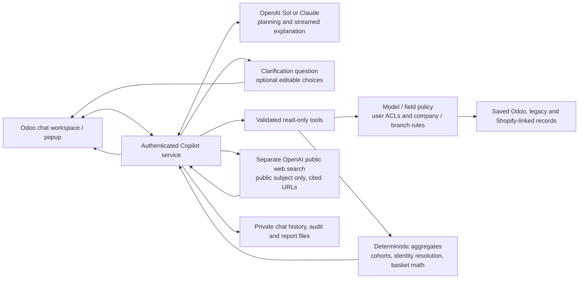

# Tradeline AI BI Copilot — executive chat

Odoo 18 add-on. Open **Tradeline AI → Chat Workspace**, or use the floating chat
button from another Odoo screen. This upgrades the existing Copilot; the separate
`tradeline_ai_invoice_chat` module is not a dependency and is not changed.

## What changed

- Claude and OpenAI can discover allowed models, inspect readable fields, and
  execute validated queries in a bounded multi-step conversation.
- Record previews, counts, sums, averages, distinct counts and date groupings use
  the Odoo ORM as the requesting user.
- Bar, line and doughnut charts use Odoo's bundled Chart.js. The chart and its
  supporting table share the same server result. Raw record IDs are never chosen
  as chart measures. Counts, refunds/negative values and zero shares are handled.
- Searchable personal chat history, follow-up context, suggested questions,
  responsive conversation drawer, floating/fullscreen modes, and error recovery.
- Replies stream from Claude/OpenAI as text arrives, with a Stop control and
  an explicit unverified notice if a response is interrupted. Tables and charts
  appear from the completed query result; prose is displayed as paragraphs.
- Excel/CSV exports preserve the query's grouping and measures, recheck current
  access, and refresh the data. A limited result is identified as limited.
- Each completed data result includes **Sources & filters**: model, execution
  time (UTC), active companies, actual filters, grouping, measures and row limit.
  Source IDs such as `[S1]` are assigned by the server and passed to the model.
  Missing/invalid citations and answers without completed queries get a warning.
  Source metadata documents the query; it does not certify the model's prose.
- Material ambiguity uses a dedicated `request_clarification` response. It ends
  the tool round before bundled data calls, offers optional editable reply
  choices, and does not display the missing-data warning. Unsupported business
  answers without a completed query still receive that warning.
- Copy-answer and jump-to-latest controls, compact supporting tables (over 12
  rows start collapsed), clearer analysis preview notices, and Tradeline brand
  artwork with a native SVG AI accent keep long conversations manageable.

## Architecture



The service has its own streaming cursor; it does not receive unsaved form data.
The selected language model receives the question, bounded recent conversation
and bounded tool results. Raw identifiers used by the identity resolver remain
inside that server-side helper. Public research is a separate request without
automatic Odoo-record or conversation attachment. API keys stay on the server.
The only writes belong to Copilot's history, audit and generated report storage.
There is no business-operation or direct live Shopify API tool. Downloads rerun
queries under current access checks.

The strongest next improvements are an administrator-approved metric/glossary
catalog (revenue, margin, refunds and product families), source freshness
indicators, a separately authorized read-only live Shopify connector, and a
benchmark of representative executive questions checked against known reports.
These are recommendations, not capabilities enabled by this UI update. Product
scope follows the user's prompt and confirmed follow-ups; example exclusions do
not become global filters. Model routing should follow measured accuracy, cost
and latency on that benchmark rather than an untested complexity heuristic.

## Configuration and upgrade

Upgrade **only `tradeline_ai_copilot`** on the intended Odoo instance, restart its
Odoo process as required, and refresh the browser assets. Existing conversations,
API keys, provider selection and model-access policies are retained. This change
does not install React, Tailwind, npm packages, a database extension, or another
Odoo application.

The streaming endpoint uses authenticated, CSRF-protected POST requests. It owns
its own database cursor and commits completed chat messages independently of the
open ERP form. Reverse proxies must permit streaming and disable response
buffering for `/ai_copilot/chat/stream`; the endpoint sends `X-Accel-Buffering: no`.
Keep its upstream timeout longer than the configured reporting time budget.

In **Tradeline AI → Administration → Settings**:

1. Select the default provider and set its API key using the administrator form.
2. Select a supported tool-capable model ID. The default for new Claude settings
   is `claude-sonnet-5-5`; existing configured model IDs are preserved and may need
   updating if retired. Check [Anthropic's current models](https://platform.claude.com/docs/en/models/overview).
3. Enable **Flexible Queries**, charts, and the required export formats.
4. Review **Model Access Policy**. Disabled models stay disabled when refreshing
   the catalog. Field allowlists, aggregation permission and export permission
   are enforced independently of Odoo's own permissions.
5. Grant **Tradeline AI / Reporting User** only to approved internal users in
   **Settings → Users & Companies → Users → Access Rights → Tradeline AI**.
   Alternatively, use developer mode **Settings → Users & Companies → Groups**,
   open **Reporting User** under Tradeline AI, and add the selected users.
   Users should refresh their browser after a membership change.

The built-in **Administrator** account receives reporting access automatically.
Other accounts, including other administrators, are opt-in: upgrading does not
automatically enrol them. Nonmembers do not see the popup or reporting menus and cannot
call chat/query/export APIs or access Copilot conversation/report models.
Administrators retain configuration, policy and audit management; they need the
Reporting User group as well to use the chat. Group membership never grants
access to additional companies, branches or underlying business records.

Both providers are supported. Enter an **OpenAI API Key** and a compatible
tool-capable **Default OpenAI Model**, then choose **OpenAI** as the default
provider or in the chat picker. Claude credentials can remain configured at the
same time. Credentials stay in the administrator-only settings on the server.

The provider picker uses these configured models, rather than obsolete hardcoded
model choices. An API key is needed for a live AI response; missing credentials
and failed connections are reported explicitly. The application never substitutes
a keyword guess and presents it as a verified flexible answer. The old query
engine remains available by disabling Flexible Queries, with a visible warning.

## Data boundaries

The read-only tools are `search_models`, `describe_model`, `query_data`,
`business_context`, `compare_customer_sets`, and `analyze_baskets`.
`research_public_web` is available when an OpenAI key is configured and the
`tradeline_ai_copilot.enable_web_search` system parameter is `True` (default).
Set it to `False` to disable public research. Web searches incur provider usage.

Customer cohorts compute full unions/differences before applying preview limits.
Keys must be saved customer relationships, not matching numbers from separate
databases. Legacy invoice lines can resolve missing customer IDs through existing
strict/linked, unambiguous invoice bridges. Other links are excluded and counted
as unresolved rows. Optional `resolve_legacy_identifiers=true` also compares
header/line phones and national IDs against current contacts without saving links.
Egyptian mobile formats and explicitly international numbers are normalized;
individual VAT values can represent structurally valid Egyptian national IDs.
Unique exact identifiers only: shared numbers, duplicate IDs and conflicting
signals stay unresolved. These are reporting matches, not authenticated identities.
Raw identifiers stay server-side and are not returned to the AI or source metadata.
The lookup includes archived contacts, applies current-user permissions, is reused
within a cohort request and refuses partial indexes above 200,000 visible contacts
or the 25-second analysis budget. Uniqueness is within readable contacts only.
If exclusions contain unresolved identities, candidates are
provisional. Duplicate contacts are not merged and returns are not automatically
netted. Filter actual handset products/categories to exclude accessory mentions.

Basket analysis deduplicates products per document and reports support,
directional confidence and lift. It is evidence of association, not causation or
profitability. Both analyses enforce source/linked-record permissions, aggregation
policies and field restrictions, use ORM reads, and fail above 50,000 grouped
keys or their time budget. Exports rerun the same analysis with current access;
metadata includes every source definition and its coverage limitations.

Public research uses a separate, nonstored OpenAI Responses request with hosted
web search. It receives a short public subject and no automatic attachment of
Odoo records or chat history. Obvious private identifiers are rejected; the
reporting agent is instructed not to place private business data in subjects.
Public evidence uses clickable `[W1]` citations; Odoo query evidence uses `[S1]`.
Web content is treated as untrusted data. Responses are bounded and require real
HTTPS citation annotations before they are accepted.
There is no write, create, delete, workflow, arbitrary Python or model-written SQL
tool. Business models are queried without `sudo`, with the active user's ACLs,
record rules and active-company context. Existing branch restrictions continue to
apply through those rules. Company access does not become broader for executives.

The add-on writes its own conversations, messages, audit records, configuration
catalog and generated report attachments. It does not post invoices, alter stock,
confirm orders or change business records. Metadata-policy and audit operations
use narrowly scoped administrator access; business queries do not.

Reports use saved records only. Unsaved invoice/order fields are never sent to
the chat endpoint. The popup does not invoke form Save, Discard, navigation or
workflow actions. Its keyboard events stay within the popup, closing restores
the prior field focus, and background response completion cannot take focus from
an ERP field. Configuration/history load when the popup is opened, rather than
adding chat requests to every backend page load. Closing the popup allows the
report to finish in the background; Stop cancels the response.

Technical models, Copilot credentials/history models, user credential records,
binary/HTML fields and secret-like fields are blocked. Field policies also apply
to filters, sorting, grouping and relationship traversal, not just output columns.
Only direct safe fields are returned; filters can traverse up to two many-to-one
relations, validating the related model and field access at each step.
Abstract services and Odoo's virtual UI helper models are excluded. A missing
custom selection callback excludes that field from reporting, so other readable
fields on the model remain available. The add-on does not modify the custom module.

Discovery is not limited to Sales/Accounting/Inventory: it uses the registry of
installed models and the administrator's policy. Search by model label, technical
name or module name, and continue in pages of 60 using `offset`. Uninstalled
applications, wizards, sensitive models and models denied by ACL/policy are not
available datasets. Reporting-group membership does not bypass these restrictions.

Queries allow up to 500 returned records/groups (also bounded by model policy),
three group dimensions, twelve fields per section, and eighty filter terms.
Each database read has an 8-second statement timeout that is restored afterwards.
Investigations default to six provider rounds, at most eight data queries, and a
total time budget capped at 90 seconds. Long text cells are limited to 2,000
characters and identified as shortened. Exports also obey format and model limits.

Monetary aggregates across multiple currencies require currency grouping. The
assistant is instructed to distinguish sales orders, invoices, POS and payments,
explain dates/refunds/taxes, and avoid treating a limited preview as a total.
Business-specific measures still need validation against the company's reports.

Questions, bounded tool results and recent conversational text are sent to the
selected provider. API keys stay server-side. Provider error bodies and keys are
not logged. Files and model output are escaped in the chat, and spreadsheet text
cannot become a formula or hyperlink merely because of its contents.

## Interface implementation

The shadcn-inspired interface is implemented in Odoo OWL, using scoped `tl-ai-*`
styles. It is not a React/shadcn application embedded in the ERP. White surfaces,
slate text, a pale conversation rail, black primary controls, blue chart accents,
1px borders and 7–12px radii form the local design system. The main chat is capped
at 860px; tables scroll within results; the composer stays visible. Focus rings,
labelled controls, live progress/error messages, RTL message direction, reduced
motion, and an accessible data table accompany charts.

## Validation

The Odoo tests in `tests/` exercise permission and company boundaries, unsafe
queries, field-policy enforcement, grouped totals, limits, grouped Excel export,
spreadsheet formulas, provider protocols/failures, follow-up context, and chat
ownership. Run with an isolated database:

```powershell
python odoo-bin -c <test-config> -d <isolated-test-db> -i tradeline_ai_copilot --without-demo=all --test-enable --test-tags /tradeline_ai_copilot --stop-after-init --max-cron-threads=0
```

Browser verification should cover saved chat → source table/chart → Excel download,
new chat → suggested prompt → answer/error → reload/history, and the mobile drawer.
Mocked-provider tests prove the integration protocol, not live model accuracy.
Validate real Claude answers against established Odoo reports in the intended
company/branch context before executive use.

Streaming regression tests also cover incremental UTF-8 text, fragmented tool
arguments, provider completion/error handling and final message persistence.
For form compatibility, test both existing drafts with unsaved changes and new
unsaved invoices/orders: open/resize/close, multiline input and form shortcuts,
stream while typing in the underlying field, complete while closed, Stop, chart
rendering and Excel download. Verify unchanged business record counts, values,
states, lines and write dates, and no business `web_save`/write/workflow requests.
