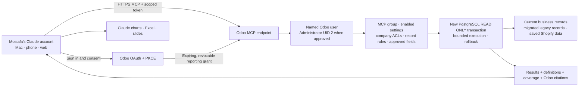

# Odoo-hosted Claude reporting

**One production rollout authorized by the user on 26 October 2026.** The user
subsequently asked to push the prepared release and test the integration live.
This supersedes the earlier deployment hold for version 18.0.1.3.0 only. Deploy
only this MCP addon, enable its fixed live Shopify reader for the existing named
Administrator reporting account, and verify the live Claude account connection.
Avoid further pushes/restarts after this rollout without another instruction.

## Release 18.0.1.3.0 — authorized for deployment; verify live status separately

Requested on 26 October: prepare live Shopify for the hosted connector and wait
for the user's explicit deployment instruction. Production remains 18.0.1.2.1.
The pending release adds a sixteenth tool, `live_shopify`, reusing the existing
Copilot fixed GraphQL order reader. No other addon implementation is changed.

- Separately disabled by default: **Allow live Shopify order reporting in MCP**.
  Requires the existing MCP group, an existing Odoo administrator, existing internal
  Shopify model policy, normal instance/company ACLs and existing valid credentials.
- `stores` exposes only accessible instance ID/name/company metadata. `connection`
  verifies live API access. `orders_summary` / `orders` read dated order cohorts.
- Existing Shopify configuration remains unavailable to generic MCP queries.
  Only the fixed reader uses the internal policy context, without sudo or a change
  of user/company. Tokens stay server-side. No sync/import, writes, refresh, arbitrary
  GraphQL, URL input, new scopes, customer details, products or inventory access.
- At most 2,000 orders and 25 seconds per live report; incomplete pagination, missing
  older-order scope, expired credentials, API failures or truncated results refuse
  totals. Order-created dates use the store timezone. All cancellation/test statuses
  stay included unless explicitly filtered. Current order value is tax-inclusive
  and is not recognized revenue or gross margin.
- Exact live queries receive Odoo source receipts and fetch timestamps. Opening a
  receipt makes another live read and can produce different values.

After a future authorized deployment: upgrade **only** this addon to 18.0.1.3.0,
review/enable the new flag, refresh Claude's tool catalogue, approve the new
read-only external tool if prompted, and verify each accessible store's connection
and paid/unfulfilled last-seven-day report. Existing OAuth account connection is
retained; a changed grant/expiry can still require reconnecting. Do not call this
live in production before those checks pass. Shopify scopes are documented at
https://shopify.dev/docs/api/admin-graphql/latest/queries/orders and
https://shopify.dev/docs/api/admin-graphql/latest/objects/order.

Local QA on 26 October: **118 tests passed, zero failures/errors** (Copilot plus
MCP, including six new Shopify boundary tests). Read-only verification of the
real local PostgreSQL boundary also passed **nine integration checks**, including
the new live-tool dispatch and rejection of unexpected writes. Read-only verification of the
existing production Copilot Shopify reader also succeeded without deployment:
TradelineStores, Cairo timezone, existing `read_orders`; `read_all_orders` absent.
For orders created 20–26 October it read all 19 orders and found 15 currently
PAID/UNFULFILLED at 10:40:49 UTC. This validates the existing store credentials,
not the still-undeployed remote MCP path. The configured 2025-10 API version was
served by Shopify as 2026-01; the reader records that actual version.

Prepared and tested on 25 October 2026. The user explicitly authorized the
necessary production deployment and testing on that date. This release contains
only the MCP addon changes on top of production `a7c407c2`; subsequent production
pushes still require authorization. Live deployment/activation must be verified
separately. No public tunnel or separate host is needed.

## Result

The existing Windows connector is a local stdio installation. It does not sync
with the Claude account. This addon adds an authenticated account-level HTTPS MCP
endpoint inside Odoo. Claude can use it on web, Mac and mobile after the connector
is added to the same account and enabled in that conversation.

Target URL: `https://tradelinestores.odoo.com/tradeline/mcp`

The addon does not add JavaScript, web-client patches, new scheduled jobs, assets or
changes to invoice/order workflows. It uses Odoo's installed Python packages;
there is no MCP SDK, ASGI server or language-model SDK dependency in Odoo.



## Authentication

- Public OAuth authorization code client; PKCE S256 is mandatory.
- Accepts only Anthropic's documented exact callback:
  `https://claude.ai/api/mcp/auth_callback`.
- Choose **Register automatically** in Claude, not its published client identity.
  Dynamic registration is supported; fetching client metadata URLs is deliberately
  unsupported, avoiding an extra SSRF surface.
- The human signs in through Odoo and explicitly approves read-only reporting.
  Odoo passwords and general-purpose API keys are never sent to Claude.
- Authorization codes expire after two minutes and can be redeemed once.
  Access tokens last one hour; rotating refresh tokens last fourteen days.
  Reuse of a consumed code/refresh token revokes its token family.
- Only SHA-256 token digests are stored. OAuth models are excluded from both
  reporting catalogues and all reporting queries.
- Credentials are accepted only in the Authorization header for MCP, never in
  the URL. Odoo session cookies alone do not authenticate MCP requests.
- Permissions, active-user status and global switches are rechecked on every
  call. Superuser UID 1 is rejected. Administrator UID 2 runs with `su=False`.
- Disconnect at `https://tradelinestores.odoo.com/tradeline/mcp/connections`,
  or disable **Enable hosted Claude connector** in Copilot settings.

OAuth grants and registration write authentication metadata in their own tables.
Business reporting is database-enforced read-only and always rolls back. No
business write tool, arbitrary RPC/model method, Python or SQL input is exposed.

## Reporting

The deployed fifteen fixed tools cover discovery, explicit field schemas, filtered/grouped
queries, current and source-aware legacy units, financial definitions, freshness,
customer cohorts, baskets and phone-based repeat customers. Existing model/field
approvals remain prerequisites; the new endpoint grants no additional business
permissions. Existing module count/coverage should be refreshed after deployment.

Repeat-customer reports count normalized phone identities, not certified distinct
humans. They report both two purchase dates and two purchase documents, plus
cross-year intersection and unmatched/invalid/conflicting phone coverage. No raw
phone numbers leave that tool. It excludes invoice-linked POS to prevent duplicate
purchase counting. Overlapping current/legacy invoice dates fail closed until
source duplication is reconciled. Ordinary invoice exports are not newly enabled.

The repeat scan uses one repeatable-read snapshot, clean ORM cache batches, a
45-second wall-time budget, a 160 MiB incremental memory budget and a transaction
lock allowing one large scan at a time across workers. Large cohorts may require
narrower periods; exceeded limits return no partial total. Actual production-size
latency remains to be measured after an approved deployment. A completed local
multi-request production read was separately saved as aggregate-only evidence;
it is not a timeless cached answer served by this endpoint.

Source links rerun the exact report under the person opening Odoo's current
permissions. They include query time and filters; they are not immutable snapshots.
Claude retains its own chart/Excel/PowerPoint features. Assets should carry the
returned definitions, period, company/currency, source links and coverage limits.

The deployed release provides saved Shopify-related Odoo data where approved.
The pending local release adds the separately gated live order reader described
above. Neither release connects to the original Odoo 12 server.

## Controlled deployment, only after approval

1. Review only this addon change against the latest production revision. Do not
   push the dirty primary checkout or unrelated connector experiments.
2. Verify a current Odoo.sh backup and choose one deployment window. Deploy this
   addon version `18.0.1.2.1` and upgrade only `tradeline_mcp_reporting`.
3. Leave existing Copilot settings/model approvals unchanged. Confirm that the
   named Administrator already has **MCP Reporting User** and the intended
   company access. Do not grant UID 1 or assign additional business permissions.
4. Confirm Odoo's canonical `web.base.url` is the HTTPS production URL and its
   reverse proxy reports HTTPS. Enable **Enable hosted Claude connector**.
   The new setting defaults to false, including on an upgrade.
5. Verify unauthenticated MCP returns 401 with OAuth discovery, discovery URLs
   work, a named authorized user sees consent, and an unauthorized user is denied.
6. In Mostafa's Claude: Settings → Connectors → Add custom connector.
   Name **Tradeline Odoo reporting**; URL above; **Sign in now**;
   OAuth client **Register automatically**. The human completes Odoo sign-in and
   consent, then approves read-only tool access in Claude.
7. In a new Claude chat, enable the web connector and check connection_info,
   reporting_coverage, a sourced query and a real executive question. Check the
   same account on Mac and phone. Do not delete the old local installation until
   the account-level connection has passed these checks.

Immediate rollback: disable only **Enable hosted Claude connector**, then revoke
the user's grants using the connections page. Existing local reporting and Odoo
business screens remain independently available. Reverting the code would be a
separate deployment and must respect the production freeze.

## Local verification

The isolated QA database loaded 108 installed Odoo modules and upgraded this addon.
Tests cover existing policies, OAuth expiry/PKCE/audience/scope, rotation/replay,
disabled users/removed groups, private authentication models, safe consent HTML,
MCP schemas/citations and blocked write tools. `verify_local_transaction.py`
tests real fresh PostgreSQL transactions, including attempted writes and the
repeatable-read snapshot. `verify_hosted_http.py` tests actual local HTTP OAuth
discovery, consent/code exchange, MCP requests, record/field rules and refresh
replay revocation. Both scripts refuse non-QA databases and restore fixtures.

Verified locally: 23 connector/phone-matching/ASGI tests, the phone-matching suite
again with production's phonenumbers 8.13.52, real PostgreSQL transaction checks,
and the complete HTTP OAuth/MCP integration flow. A local Windows ACL problem in
the old test session folder was isolated by giving the QA server its own fresh
data directory; no production directory or permissions were changed.

Final Odoo result: **26 tests passed, zero failures/errors**. The real transaction
script passed eight checks; the HTTP script passed its four end-to-end check
groups. Malformed/valid MCP initialization was also checked after input hardening.

After applying this addon to the latest production code, the combined Copilot and
MCP suite passed **112 tests, zero failures/errors**, with 108 installed local
modules loading. Odoo.sh's latest verified production restore point before this
release was the automatic daily backup at **2026-10-25 19:05:38 UTC** for revision
`a7c407c2`. Only the MCP addon is in this deployment diff.

Reference: [Anthropic custom connector setup](https://support.claude.com/en/articles/11175166-get-started-with-custom-connectors-using-remote-mcp)
and [MCP authorization requirements](https://modelcontextprotocol.io/specification/2025-11-25/basic/authorization).

## Prepared evidence-first reporting update — 27 October 2026

### Follow-up interpretation fixes — 18.0.1.3.3

Live 18.0.1.3.2 testing reconciled the repeat and Shopify figures and their
sources, but Claude still called missing-year identities new customers and
attributed repeat-count growth to the buyer base. Subsequent synthetic tests
also exposed an unsupported estimate based on squared matching coverage.
The follow-up makes these limits explicit in the deterministic summary,
initialization instructions and the selected tool's description. The latter
is available to clients that load tools lazily without rereading initialization.
Group intersections are unknown unless measured; independent phone matching is
neither established nor ruled out. These changes add no queries or permissions.

The isolated combined Odoo suite passed 139 tests, including the returned tool
catalogue. A controlled synthetic replay correctly handled acquisition,
causality, unmeasured coverage effects and unknown overlap. Such replays are
not substitutes for fresh deployed tool-use tests.

### Follow-up after live evaluation

The deployed 18.0.1.3.1 release still produced unsupported commentary in an
actual Claude repeat-customer answer, despite correctly returning the counts.
Version **18.0.1.3.2** adds a deterministic
`verified_summary` built from validated report values and explicit scope, with
no promotion of record text to instructions. It distinguishes the cross-year
overlap from within-year repeat groups, and explicitly states when the effect
of unequal reporting windows is unmeasured. Incomplete or malformed context
does not become a verified summary. No access or business-data behavior was
expanded.

A full isolated Odoo run passed 139 tests and 10 real local PostgreSQL checks;
the updated calculation tests passed again after the final wording change.
Synthetic Claude replays are recorded separately and are not live deployment
verification. Early replays still produced unsupported prose, demonstrating that
extra guidance and a deterministic summary cannot guarantee the model's final
answer. After the overlap and window caveats were strengthened, the last
synthetic replay correctly distinguished the customer groups and declined to
explain the cause; it still used ambiguous "real change" wording. The MCP
server cannot intercept or enforce the final answer generated
inside the Claude application. A subsequent wording change explicitly warns
that unequal-period differences alone do not prove a change in behaviour.
The user subsequently authorized deployment when ready, with read-only testing.
In a further synthetic replay Claude still asserted that a shorter window would
lower the repeat share while also saying its effect was unknown. The summary
now explains that the denominator may also change. The next synthetic replay
reported the figures correctly and did not claim a directional window effect.
This replay used simulated evidence in a user message, not a live tool result;
post-deployment checks must separately assess Claude and the returned sources.

**The user authorized one production push of version 18.0.1.3.1 on 27 October
2026, followed by read-only live verification.** That deployment's base was
version 18.0.1.3.0.

The fixed reporting bridge attaches an `answer_contract` to dictionary tool
responses, shared by hosted Claude clients and the existing RPC/stdio client.
It preserves the original rows, filters, citations and access rules. It adds no
tools, model/field grants, database queries, background tasks or model API calls.
The contract is first in the response so it is available even when the client
loads tools lazily or retains earlier initialization instructions. Tool
descriptions and server instructions also state the evidence policy.

Complete repeat-customer reports now include deterministic shares and separate
cross-year-versus-within-year comparisons for each year. Live Shopify summaries
include reconciled counts and totals separated by currency. Inconsistent,
incomplete or truncated evidence gets no derived headline total. These are
calculations over the returned evidence, not inferred customer behaviour.

Tool-specific limits cover shipment identity, physical returns, loyalty and
upgrade cycles, historical coverage, missing stores, margin completeness,
cohort identity and bundle causation. A confidence label is not evidence.
Recommendations remain possible, with untested hypotheses and their required
checks distinguished from facts. The same definitions apply to charts/files.

Validation includes the pure arithmetic/coverage regression suite, the combined
local Odoo tests and the real PostgreSQL read-only/ACL tests. Controlled Claude
replays use synthetic fixtures, without production calls or business changes.
Final local result: **134 Odoo tests passed, zero failures/errors; 10 real
PostgreSQL checks passed.** Nine synthetic Claude cases (six with initialization
instructions, three held-out cases with the per-result contract alone) passed
their first-response review without a correction prompt. These cases cover the
observed failures and selected edge cases, not all possible executive questions.
Run the pure tests with:

```powershell
python tradeline_mcp_reporting/tests/test_answer_contract.py
```

The fixtures and grading rubrics are in
`tests/fixtures/answer_contract_cases.json`. Keep evaluation outputs distinct
from actual company reports. A replay that supplies a proposed contract in chat
is not a deployed end-to-end test. After an authorized rollout, start a fresh
Claude chat and repeat the real questions. Refresh the connector's tool list to
pick up description changes; every fresh tool response carries the contract
regardless of that cache. This server cannot intercept or guarantee the prose
generated by an external Claude client, so passing examples are regression
evidence, not a universal accuracy guarantee.

Design reference: [Anthropic on tool descriptions, useful responses and evaluations](https://www.anthropic.com/engineering/writing-tools-for-agents).

## Browser callback correction — 26 October 2026

Chrome submitted the human's consent but blocked its 303 redirect because the
consent page had `form-action 'self'`. Odoo created unconsumed authorization codes,
while Claude remained unconnected. The HTTP integration test did not exercise
browser Content Security Policy enforcement.

Version 18.0.1.2.1 allows the existing exact `CLAUDE_CALLBACKS` allowlist in the
approval page's form-action policy. Disconnect and error pages stay self-only;
CSRF, callback URI validation, PKCE, company/model/field rules and grant lifetimes
are unchanged. No wildcard hosts or broad HTTPS exceptions are added.

The failure was reproduced with a synthetic local Chrome form (POST reached the
server but its callback was never reached); adding only the intended callback
allowed the redirect. All 26 MCP tests passed, including assertions for the narrow
callback policy and unchanged self-only policy elsewhere. See
[MDN's form-action redirect behavior](https://developer.mozilla.org/en-US/docs/Web/HTTP/Reference/Headers/Content-Security-Policy/form-action).
