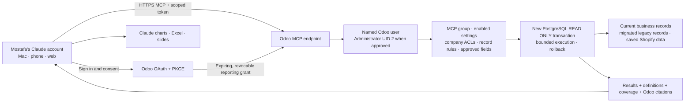

# Odoo-hosted Claude reporting

Prepared and tested on 25 October 2026. The user explicitly authorized the
necessary production deployment and testing on that date. This release contains
only the MCP addon changes on top of production `a7c407c2`; subsequent production
pushes still require authorization. Live deployment/activation must be verified
separately. No public tunnel or separate host is needed.

## Result

The existing Windows connector is a local stdio installation. It does not sync
with the Claude account. This addon adds an authenticated account-level HTTPS MCP
endpoint inside Odoo. Claude can use it on web, Mac and mobile after the connector
is added to the same account and enabled in that conversation.

Target URL: `https://tradelinestores.odoo.com/tradeline/mcp`

The addon does not add JavaScript, web-client patches, new scheduled jobs, assets or
changes to invoice/order workflows. It uses Odoo's installed Python packages;
there is no MCP SDK, ASGI server or language-model SDK dependency in Odoo.

## Authentication

- Public OAuth authorization code client; PKCE S256 is mandatory.
- Accepts only Anthropic's documented exact callback:
  `https://claude.ai/api/mcp/auth_callback`.
- Choose **Register automatically** in Claude, not its published client identity.
  Dynamic registration is supported; fetching client metadata URLs is deliberately
  unsupported, avoiding an extra SSRF surface.
- The human signs in through Odoo and explicitly approves read-only reporting.
  Odoo passwords and general-purpose API keys are never sent to Claude.
- Authorization codes expire after two minutes and can be redeemed once.
  Access tokens last one hour; rotating refresh tokens last fourteen days.
  Reuse of a consumed code/refresh token revokes its token family.
- Only SHA-256 token digests are stored. OAuth models are excluded from both
  reporting catalogues and all reporting queries.
- Credentials are accepted only in the Authorization header for MCP, never in
  the URL. Odoo session cookies alone do not authenticate MCP requests.
- Permissions, active-user status and global switches are rechecked on every
  call. Superuser UID 1 is rejected. Administrator UID 2 runs with `su=False`.
- Disconnect at `https://tradelinestores.odoo.com/tradeline/mcp/connections`,
  or disable **Enable hosted Claude connector** in Copilot settings.

OAuth grants and registration write authentication metadata in their own tables.
Business reporting is database-enforced read-only and always rolls back. No
business write tool, arbitrary RPC/model method, Python or SQL input is exposed.

## Reporting

Fifteen fixed tools cover discovery, explicit field schemas, filtered/grouped
queries, current and source-aware legacy units, financial definitions, freshness,
customer cohorts, baskets and phone-based repeat customers. Existing model/field
approvals remain prerequisites; the new endpoint grants no additional business
permissions. Existing module count/coverage should be refreshed after deployment.

Repeat-customer reports count normalized phone identities, not certified distinct
humans. They report both two purchase dates and two purchase documents, plus
cross-year intersection and unmatched/invalid/conflicting phone coverage. No raw
phone numbers leave that tool. It excludes invoice-linked POS to prevent duplicate
purchase counting. Overlapping current/legacy invoice dates fail closed until
source duplication is reconciled. Ordinary invoice exports are not newly enabled.

The repeat scan uses one repeatable-read snapshot, clean ORM cache batches, a
45-second wall-time budget, a 160 MiB incremental memory budget and a transaction
lock allowing one large scan at a time across workers. Large cohorts may require
narrower periods; exceeded limits return no partial total. Actual production-size
latency remains to be measured after an approved deployment. A completed local
multi-request production read was separately saved as aggregate-only evidence;
it is not a timeless cached answer served by this endpoint.

Source links rerun the exact report under the person opening Odoo's current
permissions. They include query time and filters; they are not immutable snapshots.
Claude retains its own chart/Excel/PowerPoint features. Assets should carry the
returned definitions, period, company/currency, source links and coverage limits.

Saved Shopify-related Odoo data is available where approved. This does not add a
live Shopify API connection or a connection to the original Odoo 12 server.

## Controlled deployment, only after approval

1. Review only this addon change against the latest production revision. Do not
   push the dirty primary checkout or unrelated connector experiments.
2. Verify a current Odoo.sh backup and choose one deployment window. Deploy this
   addon version `18.0.1.2.0` and upgrade only `tradeline_mcp_reporting`.
3. Leave existing Copilot settings/model approvals unchanged. Confirm that the
   named Administrator already has **MCP Reporting User** and the intended
   company access. Do not grant UID 1 or assign additional business permissions.
4. Confirm Odoo's canonical `web.base.url` is the HTTPS production URL and its
   reverse proxy reports HTTPS. Enable **Enable hosted Claude connector**.
   The new setting defaults to false, including on an upgrade.
5. Verify unauthenticated MCP returns 401 with OAuth discovery, discovery URLs
   work, a named authorized user sees consent, and an unauthorized user is denied.
6. In Mostafa's Claude: Settings → Connectors → Add custom connector.
   Name **Tradeline Odoo reporting**; URL above; **Sign in now**;
   OAuth client **Register automatically**. The human completes Odoo sign-in and
   consent, then approves read-only tool access in Claude.
7. In a new Claude chat, enable the web connector and check connection_info,
   reporting_coverage, a sourced query and a real executive question. Check the
   same account on Mac and phone. Do not delete the old local installation until
   the account-level connection has passed these checks.

Immediate rollback: disable only **Enable hosted Claude connector**, then revoke
the user's grants using the connections page. Existing local reporting and Odoo
business screens remain independently available. Reverting the code would be a
separate deployment and must respect the production freeze.

## Local verification

The isolated QA database loaded 108 installed Odoo modules and upgraded this addon.
Tests cover existing policies, OAuth expiry/PKCE/audience/scope, rotation/replay,
disabled users/removed groups, private authentication models, safe consent HTML,
MCP schemas/citations and blocked write tools. `verify_local_transaction.py`
tests real fresh PostgreSQL transactions, including attempted writes and the
repeatable-read snapshot. `verify_hosted_http.py` tests actual local HTTP OAuth
discovery, consent/code exchange, MCP requests, record/field rules and refresh
replay revocation. Both scripts refuse non-QA databases and restore fixtures.

Verified locally: 23 connector/phone-matching/ASGI tests, the phone-matching suite
again with production's phonenumbers 8.13.52, real PostgreSQL transaction checks,
and the complete HTTP OAuth/MCP integration flow. A local Windows ACL problem in
the old test session folder was isolated by giving the QA server its own fresh
data directory; no production directory or permissions were changed.

Final Odoo result: **26 tests passed, zero failures/errors**. The real transaction
script passed eight checks; the HTTP script passed its four end-to-end check
groups. Malformed/valid MCP initialization was also checked after input hardening.

After applying this addon to the latest production code, the combined Copilot and
MCP suite passed **112 tests, zero failures/errors**, with 108 installed local
modules loading. Odoo.sh's latest verified production restore point before this
release was the automatic daily backup at **2026-10-25 19:05:38 UTC** for revision
`a7c407c2`. Only the MCP addon is in this deployment diff.

Reference: [Anthropic custom connector setup](https://support.claude.com/en/articles/11175166-get-started-with-custom-connectors-using-remote-mcp)
and [MCP authorization requirements](https://modelcontextprotocol.io/specification/2025-11-25/basic/authorization).
